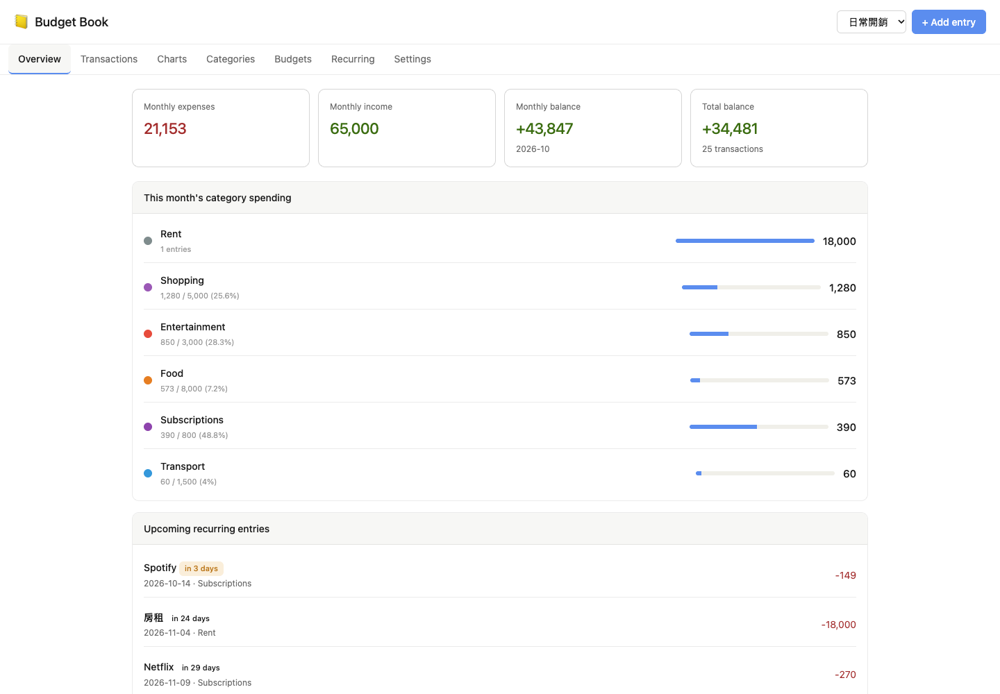
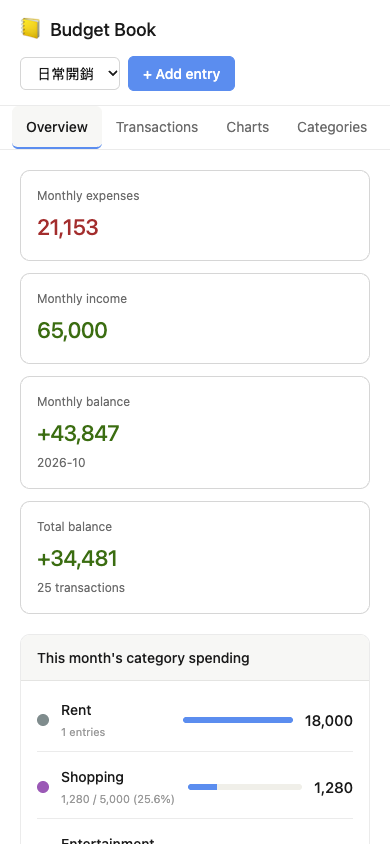
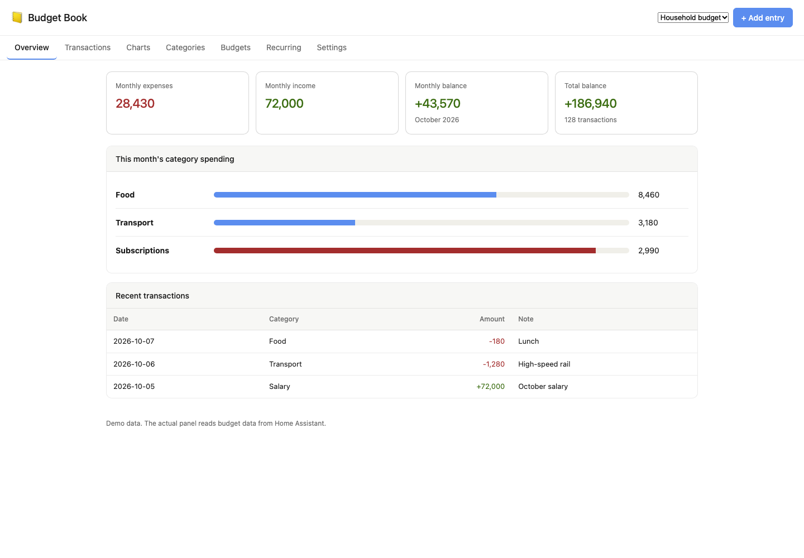

# Home-Assistant 記帳本 (Budget Book)

[繁體中文](README.zh-TW.md) | [简体中文](README.zh-CN.md)

[](https://developers.home-assistant.io/docs/add-ons/)
[](https://github.com/hacs/integration)

Budget Book is a Home Assistant budgeting app that now supports both **Supervisor Add-on** and **HACS custom integration** installation from this same repository.

- **Supervisor Add-on:** runs the same Budget Book interface through ingress, stores data in `/data/budget_book.json`, and provides its own add-on API.
- **HACS integration:** keeps the original Home Assistant entity, sensor, service, sidebar panel, and HA storage behavior.
- **Shared core:** frontend UI, language files, analytics, data shape, import/export behavior, sample data, and migration logic are kept in `shared/core/` and synced into both adapters.

Current version: Supervisor Add-on and HACS integration `v1.2.4`.

## Screenshots

### Supervisor Add-on

| Desktop | Mobile |
| --- | --- |
|  |  |

### HACS Integration

| Overview | Transactions |
| --- | --- |
|  |  |

| Charts | Budgets |
| --- | --- |
|  |  |

## Features

- Multiple budget books for household, personal, or project expenses.
- Income and expense records with category, note, date, and time.
- Monthly expense, monthly income, monthly balance, and total balance summaries.
- Category spending, six-month trend, and budget usage charts.
- Monthly category budgets with 80% warnings and over-budget alerts.
- Recurring monthly entries checked automatically every day at 09:00.
- JSON import/export, sample data, and clear-book tools.
- Built-in English, Traditional Chinese, and Simplified Chinese UI.
- Auto language mode follows Home Assistant language, with manual override in Budget Book settings.

## Installation

### Supervisor Add-on Store Repository

[](https://my.home-assistant.io/redirect/supervisor_add_addon_repository/?repository_url=https%3A%2F%2Fgithub.com%2FIm-Tim-mI%2FHome-Assistant_Budget-Book)

1. Open Home Assistant.
2. Go to Settings -> Add-ons -> Add-on Store.
3. Open the top-right menu and choose `Repositories`.
4. Add this repository URL:

   ```text
   https://github.com/Im-Tim-mI/Home-Assistant_Budget-Book
   ```

5. Install `Budget Book`.
6. Start the add-on and open it from the sidebar or add-on page.

### HACS Custom Repository

[](https://my.home-assistant.io/redirect/hacs_repository/?owner=Im-Tim-mI&repository=Home-Assistant_Budget-Book&category=integration)

1. Open HACS in Home Assistant.
2. Open the three-dot menu and choose `Custom repositories`.
3. Add this repository URL:

   ```text
   https://github.com/Im-Tim-mI/Home-Assistant_Budget-Book
   ```

4. Select category `Integration`.
5. Install `Home-Assistant 記帳本 (Budget Book)`.
6. Restart Home Assistant.
7. Go to Settings -> Devices & services -> Add integration, then search for `Budget Book` or `記帳本`.

### Manual HACS Integration Install

Copy only the integration folder to Home Assistant:

```bash
mkdir -p /config/custom_components
cp -R custom_components/budget_book /config/custom_components/budget_book
```

Then restart Home Assistant and add the integration from Settings -> Devices & services.

## Which Install Should I Use?

Use **Supervisor Add-on** if you prefer an add-on app with ingress and Docker isolation.

Use **HACS integration** if you want the original behavior: registered HA services, Home Assistant storage, and normal custom integration entities.

You can install both on the same Home Assistant instance. When both are present, the HACS integration's HA storage becomes the shared source of truth. On startup, the add-on migrates existing `/data/budget_book.json` data into the integration if the integration is still empty; if the integration already has data, the add-on adopts that data and keeps a timestamped local backup before replacing its own copy. After add-on changes, it syncs back through `budget_book.replace_data`.

## Repository Structure

```text
.
├── budget_book/                     # Supervisor Add-on
├── custom_components/budget_book/   # HACS integration
├── shared/core/                     # shared source for UI/data/analytics/migration
├── scripts/sync_shared_core.py      # syncs shared core into both adapters
├── repository.yaml
└── hacs.json
```

When changing shared behavior, edit `shared/core/` first, then run:

```bash
python3 scripts/sync_shared_core.py
```

## HACS Services

The integration provides `budget_book.*` services for automations and Developer Tools:

- `budget_book.add_transaction`
- `budget_book.delete_transaction`
- `budget_book.create_book`
- `budget_book.set_budget`
- `budget_book.add_category`
- `budget_book.add_recurring`
- `budget_book.run_recurring`
- `budget_book.replace_data`

See `custom_components/budget_book/services.yaml` for full field definitions.

## Development Checks

```bash
python3 scripts/sync_shared_core.py
python3 -m py_compile custom_components/budget_book/*.py budget_book/rootfs/app/*.py
ruby -e 'require "yaml"; YAML.load_file("repository.yaml"); YAML.load_file("budget_book/config.yaml")'
python3 -m unittest tests/test_addon.py tests/test_analytics.py
```

## License

MIT
