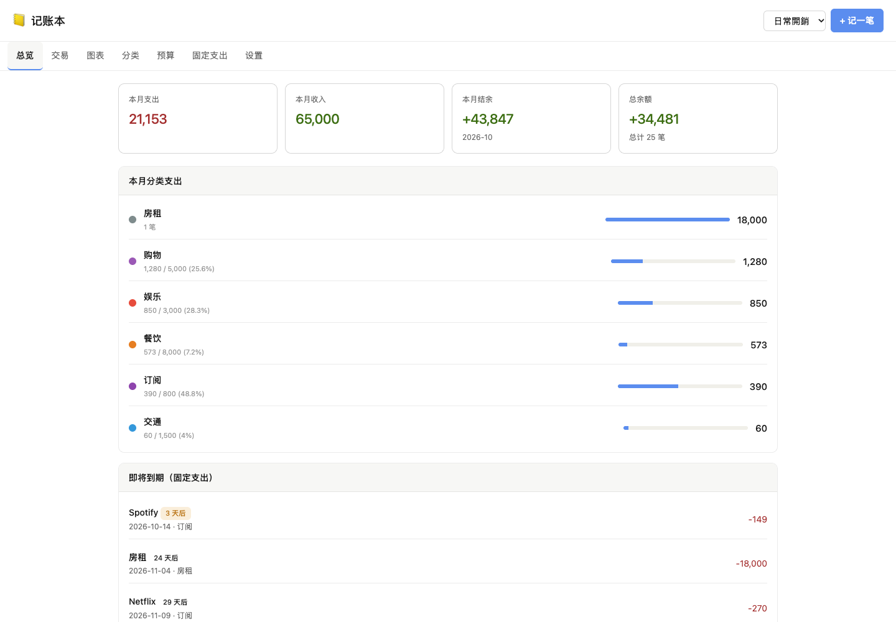
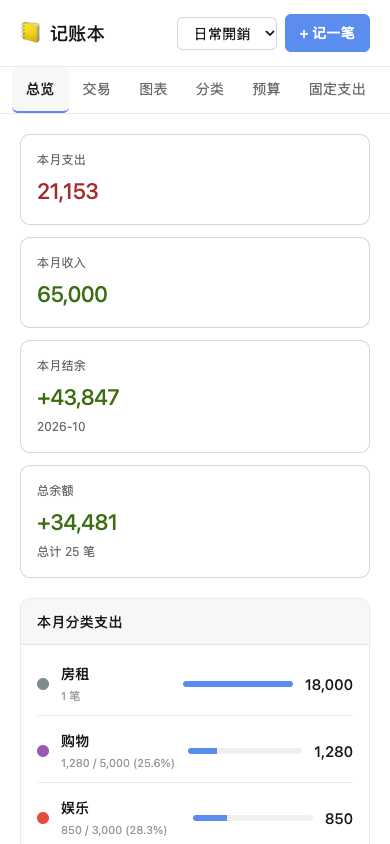
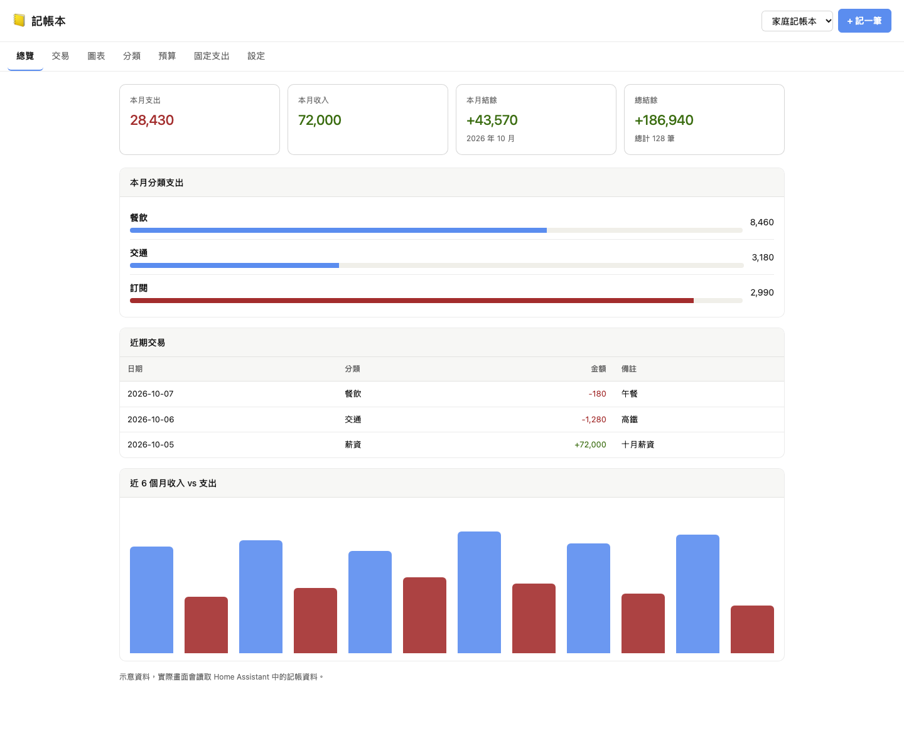
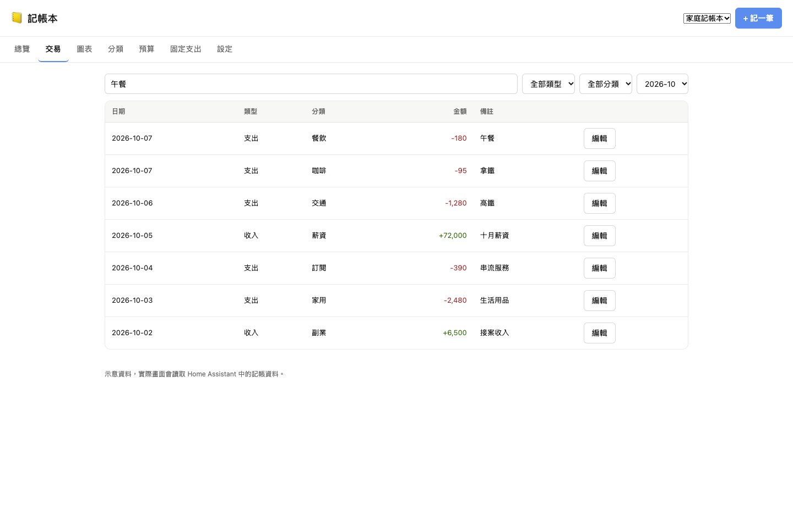
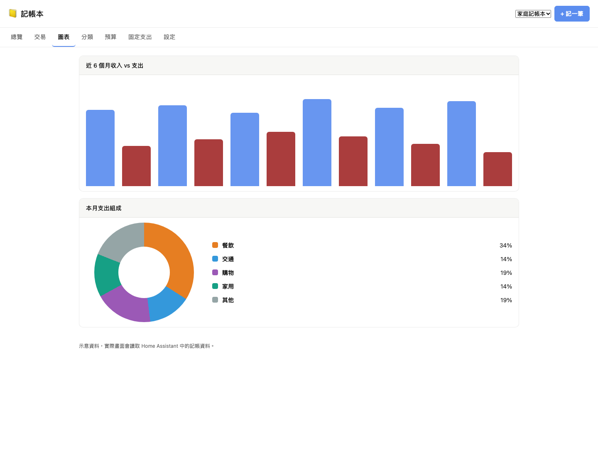
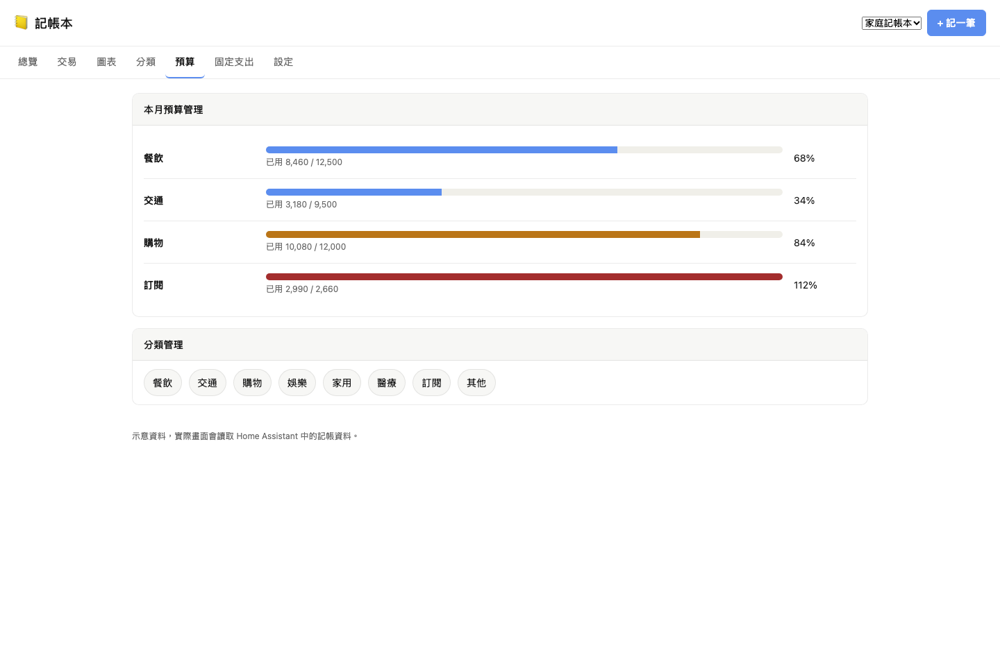

# Home-Assistant 记账本 (Budget Book)

[English](README.md) | [繁體中文](README.zh-TW.md)

[](https://developers.home-assistant.io/docs/add-ons/)
[](https://github.com/hacs/integration)

记账本现在改成同一个 GitHub repository 同时支持 **Supervisor Add-on** 和 **HACS custom integration** 安装。

- **Supervisor Add-on：** 使用同一套记账本界面，通过 ingress 打开，数据存放在 `/data/budget_book.json`，并提供 add-on API。
- **HACS integration：** 保留原本 Home Assistant entity、sensor、service、侧边栏面板与 HA storage 行为。
- **共用核心：** 前端 UI、语言文件、分析逻辑、数据格式、导入导出、示例数据与 migration 放在 `shared/core/`，再同步到两个 adapter。

当前版本：Supervisor Add-on 与 HACS integration 皆为 `v1.2.5b2`。

## 广告：罗技 Logi 台湾网络旗舰店折扣码

罗技 Logi 台湾网络旗舰店**电竞类别九折**，结账页面输入折扣码 **`LOGITIM`** 即可使用，有效期至 **2026/12/31**。

[](https://store.logitech.tw/discount/LOGITIM)

👉 [点此前往并自动套用折扣](https://store.logitech.tw/discount/LOGITIM)

## 截图

### Supervisor Add-on

| 桌面版 | 手机版 |
| --- | --- |
|  |  |

### HACS Integration

| 总览 | 交易 |
| --- | --- |
|  |  |

| 图表 | 预算 |
| --- | --- |
|  |  |

## 功能

- 多本记账本管理，可分别记录家庭、个人或项目支出。
- 收入、支出、分类、备注与日期时间记录。
- 月度支出、收入、结余与总余额统计。
- 分类支出、近 6 个月趋势与预算使用率图表。
- 每月分类预算与 80% / 超支提醒。
- 固定支出规则，每天 09:00 自动检查并写入到期项目。
- JSON 导入、导出、示例数据载入与清空工具。
- 内置 English、繁體中文、简体中文界面语言。
- 自动语言会跟随 Home Assistant 语言，也可以在记账本设置中手动指定。

## 安装

### Supervisor Add-on Store Repository

[](https://my.home-assistant.io/redirect/supervisor_add_addon_repository/?repository_url=https%3A%2F%2Fgithub.com%2FIm-Tim-mI%2FHome-Assistant_Budget-Book)

1. 打开 Home Assistant。
2. 前往“设置”→“Add-ons”→“Add-on Store”。
3. 点击右上角菜单，选择 `Repositories`。
4. 加入 repository URL：

   ```text
   https://github.com/Im-Tim-mI/Home-Assistant_Budget-Book
   ```

5. 安装 `Budget Book`。
6. 启动 add-on，从侧边栏或 add-on 页面打开。

### HACS Custom Repository

[](https://my.home-assistant.io/redirect/hacs_repository/?owner=Im-Tim-mI&repository=Home-Assistant_Budget-Book&category=integration)

1. 在 Home Assistant 打开 HACS。
2. 点击右上角三点菜单，选择 `Custom repositories`。
3. 加入 repository URL：

   ```text
   https://github.com/Im-Tim-mI/Home-Assistant_Budget-Book
   ```

4. Category 选择 `Integration`。
5. 安装 `Home-Assistant 记账本 (Budget Book)`。
6. 重新启动 Home Assistant。
7. 到“设置”→“设备与服务”→“添加集成”，搜索 `Budget Book` 或 `记账本`。

### 手动安装 HACS Integration

只复制 integration 文件夹到 Home Assistant：

```bash
mkdir -p /config/custom_components
cp -R custom_components/budget_book /config/custom_components/budget_book
```

然后重新启动 Home Assistant，并到“设备与服务”添加集成。

## 该用哪一种？

如果你想用 add-on app、ingress 与 Docker 隔离，请用 **Supervisor Add-on**。

如果你要原本的 Home Assistant 行为，例如正式注册的 `budget_book.*` service、HA storage、entity 与 sensor，请用 **HACS integration**。

可以在同一个 Home Assistant 内同时安装两者。两者都存在时，HACS integration 的 HA storage 会作为共通数据来源。Add-on 启动时如果 integration 仍是空的，会把既有 `/data/budget_book.json` 自动迁移进 integration；如果 integration 已经有数据，Add-on 会改用 integration 的数据，并在覆盖自己的本地数据前保留时间戳备份。之后 Add-on 端的变更会通过 `budget_book.replace_data` 同步回 integration。

## Repository 结构

```text
.
├── budget_book/                     # Supervisor Add-on
├── custom_components/budget_book/   # HACS integration
├── shared/core/                     # UI、数据格式、分析与 migration 共用来源
├── scripts/sync_shared_core.py      # 同步共用核心到两个 adapter
├── repository.yaml
└── hacs.json
```

修改共用功能时，先改 `shared/core/`，再执行：

```bash
python3 scripts/sync_shared_core.py
```

## HACS Services

Integration 提供 `budget_book.*` 服务，可从自动化或开发者工具调用：

- `budget_book.add_transaction`
- `budget_book.delete_transaction`
- `budget_book.create_book`
- `budget_book.set_budget`
- `budget_book.add_category`
- `budget_book.add_recurring`
- `budget_book.run_recurring`
- `budget_book.replace_data`

完整字段定义请看 `custom_components/budget_book/services.yaml`。

## 开发检查

```bash
python3 scripts/sync_shared_core.py
python3 -m py_compile custom_components/budget_book/*.py budget_book/rootfs/app/*.py
ruby -e 'require "yaml"; YAML.load_file("repository.yaml"); YAML.load_file("budget_book/config.yaml")'
python3 -m unittest tests/test_addon.py tests/test_analytics.py
```

## 授权

MIT
