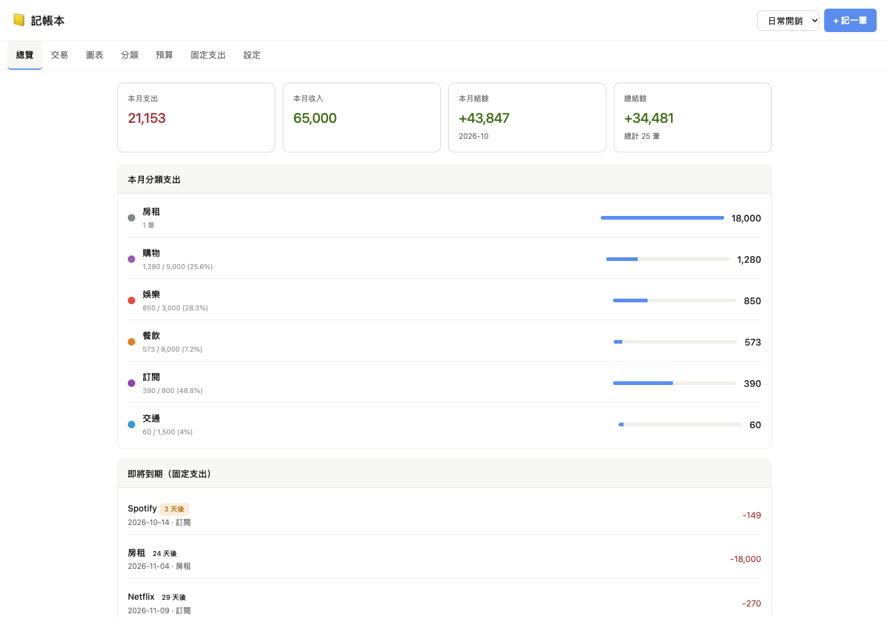
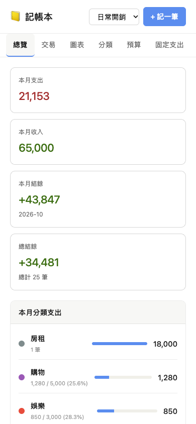

# Home-Assistant 記帳本 (Budget Book)

[English](README.md) | [简体中文](README.zh-CN.md)

[](https://developers.home-assistant.io/docs/add-ons/)
[](https://github.com/hacs/integration)

記帳本現在改成同一個 GitHub repository 同時支援 **Supervisor Add-on** 和 **HACS custom integration** 安裝。

- **Supervisor Add-on：** 使用同一套記帳本介面，透過 ingress 開啟，資料存在 `/data/budget_book.json`，並提供 add-on API。
- **HACS integration：** 保留原本 Home Assistant entity、sensor、service、側邊欄面板與 HA storage 行為。
- **共用核心：** 前端 UI、語言檔、分析邏輯、資料格式、匯入匯出、範例資料與 migration 放在 `shared/core/`，再同步到兩個 adapter。

目前版本：Supervisor Add-on 與 HACS integration 皆為 `v1.2.5b4`。

## 廣告：羅技 Logi 網路旗艦店折扣碼

羅技 Logi 網路旗艦店**電競類別九折**，結帳頁面輸入折扣碼 **`LOGITIM`** 即可使用，可以使用到 **2026/12/31**。

[](https://store.logitech.tw/discount/LOGITIM)

👉 [點此前往並自動套用折扣](https://store.logitech.tw/discount/LOGITIM)

## 截圖

### Supervisor Add-on

| 桌面版 | 手機版 |
| --- | --- |
|  |  |

### HACS Integration

| 總覽 | 交易 |
| --- | --- |
|  |  |

| 圖表 | 預算 |
| --- | --- |
|  |  |

## 功能

- 多本記帳本管理，可分開紀錄家庭、個人或專案支出。
- 收入、支出、分類、備註與日期時間紀錄。
- 月度支出、收入、結餘與總結餘統計。
- 分類支出、近 6 個月趨勢與預算使用率圖表。
- 每月分類預算與 80% / 超支提醒。
- 固定支出規則，每天 09:00 自動檢查並寫入到期項目。
- JSON 匯入、匯出、範例資料載入與清空工具。
- 內建 English、繁體中文、简体中文介面語系。
- 自動語系會跟隨 Home Assistant 語系，也可在記帳本設定中手動指定。

## 安裝

### Supervisor Add-on Store Repository

[](https://my.home-assistant.io/redirect/supervisor_add_addon_repository/?repository_url=https%3A%2F%2Fgithub.com%2FIm-Tim-mI%2FHome-Assistant_Budget-Book)

1. 開啟 Home Assistant。
2. 前往「設定」→「Add-ons」→「Add-on Store」。
3. 點右上角選單，選擇 `Repositories`。
4. 加入 repository URL：

   ```text
   https://github.com/Im-Tim-mI/Home-Assistant_Budget-Book
   ```

5. 安裝 `Budget Book`。
6. 啟動 add-on，從側邊欄或 add-on 頁面開啟。

### HACS Custom Repository

[](https://my.home-assistant.io/redirect/hacs_repository/?owner=Im-Tim-mI&repository=Home-Assistant_Budget-Book&category=integration)

1. 在 Home Assistant 開啟 HACS。
2. 點右上角三點選單，選擇 `Custom repositories`。
3. 加入 repository URL：

   ```text
   https://github.com/Im-Tim-mI/Home-Assistant_Budget-Book
   ```

4. Category 選 `Integration`。
5. 安裝 `Home-Assistant 記帳本 (Budget Book)`。
6. 重新啟動 Home Assistant。
7. 到「設定」→「裝置與服務」→「新增整合」，搜尋 `Budget Book` 或 `記帳本`。

### 手動安裝 HACS Integration

只複製 integration 資料夾到 Home Assistant：

```bash
mkdir -p /config/custom_components
cp -R custom_components/budget_book /config/custom_components/budget_book
```

接著重新啟動 Home Assistant，並到「裝置與服務」新增整合。

## 該用哪一種？

如果你想用 add-on app、ingress 與 Docker 隔離，請用 **Supervisor Add-on**。

如果你要原本的 Home Assistant 行為，例如正式註冊的 `budget_book.*` service、HA storage、entity 與 sensor，請用 **HACS integration**。

可以在同一個 Home Assistant 內同時安裝兩者。當兩者都存在時，HACS integration 的 HA storage 會作為共通資料來源。Add-on 啟動時如果 integration 還是空的，會把既有 `/data/budget_book.json` 自動遷移進 integration；如果 integration 已經有資料，Add-on 會改用 integration 的資料，並在覆蓋自己的本地資料前保留時間戳備份。之後 Add-on 端的變更會透過 `budget_book.replace_data` 同步回 integration。

## Repository 結構

```text
.
├── budget_book/                     # Supervisor Add-on
├── custom_components/budget_book/   # HACS integration
├── shared/core/                     # UI、資料格式、分析與 migration 共用來源
├── scripts/sync_shared_core.py      # 同步共用核心到兩個 adapter
├── repository.yaml
└── hacs.json
```

修改共用功能時，先改 `shared/core/`，再執行：

```bash
python3 scripts/sync_shared_core.py
```

## HACS Services

Integration 提供 `budget_book.*` 服務，可從自動化或開發者工具呼叫：

- `budget_book.add_transaction`
- `budget_book.delete_transaction`
- `budget_book.create_book`
- `budget_book.set_budget`
- `budget_book.add_category`
- `budget_book.add_recurring`
- `budget_book.run_recurring`
- `budget_book.replace_data`

完整欄位定義請看 `custom_components/budget_book/services.yaml`。

## 開發檢查

```bash
python3 scripts/sync_shared_core.py
python3 -m py_compile custom_components/budget_book/*.py budget_book/rootfs/app/*.py
ruby -e 'require "yaml"; YAML.load_file("repository.yaml"); YAML.load_file("budget_book/config.yaml")'
python3 -m unittest tests/test_addon.py tests/test_analytics.py
```

## 授權

MIT
